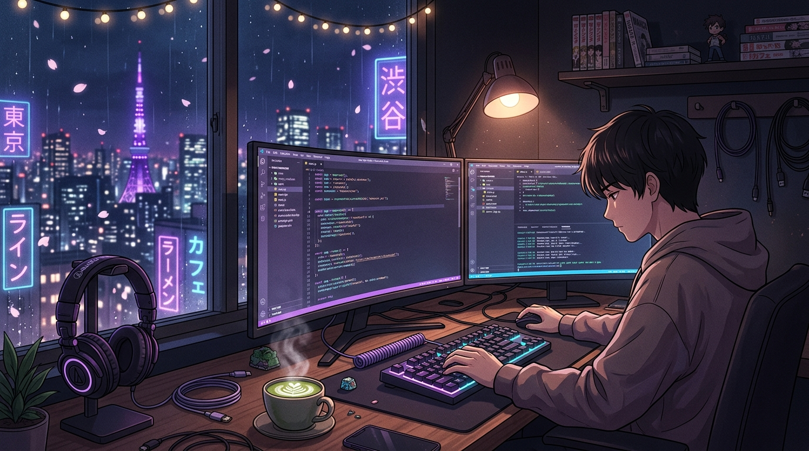

  <!-- Header Banner -->
  

    

  <!-- Animated Typing Intro -->
  

  

    <b>Full-Stack Engineer & Problem Solver</b> • Focused on crafting scalable platforms and intuitive user experiences.
  

  <!-- Contact Badges -->
  

    
    
    
    
    
    
  

---

### ⚡ About Me

I engineer high-performance web applications and resilient backend systems. Driven by clean code principles, data structures, and intuitive interface design, I transform complex technical requirements into elegant, scalable software.

- 🚀 **Currently Building**: Scalable full-stack web platforms, distributed microservices, and AI-augmented developer tooling.
- 🧠 **Currently Learning**: Advanced Distributed Systems, event-driven architectures, and deep algorithmic optimization.
- 💬 **Ask Me About**: TypeScript, React, Next.js, Node.js, Python, PostgreSQL, and REST/GraphQL API design.
- ⚡ **Philosophy**: Code should be readable, systems should be fault-tolerant, and user interfaces should feel effortless.

---

### 🛠️ Tech Stack & Arsenal

#### Languages & Core Technologies

  

#### Frontend & UI Engineering

  

#### Backend, Databases & Cloud

  

#### Tools & DevOps Workflow

  

---

### 🚀 Pinned Projects

<table>
  <tr>
    <td width="50%" valign="top">
      <h4><a href="https://github.com/adisharma9548">🌸 AnimeStream Lounge</a></h4>
      
High-velocity streaming platform featuring GraphQL catalog sync, episode progress tracking, and interactive community discussion rooms.

      

        
        
        
        
      

    </td>
    <td width="50%" valign="top">
      <h4><a href="https://github.com/adisharma9548">⚡ NeuralForge AI</a></h4>
      
Developer assistant offering automated code refactoring, AST bug analysis, and real-time semantic vector codebase search.

      

        
        
        
        
      

    </td>
  </tr>
  <tr>
    <td width="50%" valign="top">
      <h4><a href="https://github.com/adisharma9548">🎧 Lo-Fi Synthwave Studio</a></h4>
      
In-browser procedural synthesizer composing real-time ambient jazz progressions, vinyl noise, and rainfall with Web Audio API.

      

        
        
        
      

    </td>
    <td width="50%" valign="top">
      <h4><a href="https://github.com/adisharma9548">💻 Cyber CLI Portfolio Engine</a></h4>
      
Interactive web-based developer terminal simulation featuring Neofetch profiles, matrix rain animations, and GitHub telemetry sync.

      

        
        
        
      

    </td>
  </tr>
</table>

---

### 📊 GitHub Analytics & Telemetry

  <!-- Responsive Dark / Light Mode Stats -->
  <picture>
    <source media="(prefers-color-scheme: dark)" srcset="https://github-readme-stats.vercel.app/api?username=adisharma9548&show_icons=true&theme=tokyonight&hide_border=true&bg_color=0d1117&title_color=38bdf8&icon_color=818cf8&text_color=e2e8f0" />
    <source media="(prefers-color-scheme: light)" srcset="https://github-readme-stats.vercel.app/api?username=adisharma9548&show_icons=true&theme=default&hide_border=true" />
    
  </picture>
  <picture>
    <source media="(prefers-color-scheme: dark)" srcset="https://github-readme-stats.vercel.app/api/top-langs/?username=adisharma9548&layout=compact&theme=tokyonight&hide_border=true&bg_color=0d1117&title_color=38bdf8&text_color=e2e8f0" />
    <source media="(prefers-color-scheme: light)" srcset="https://github-readme-stats.vercel.app/api/top-langs/?username=adisharma9548&layout=compact&theme=default&hide_border=true" />
    
  </picture>

    

  <!-- LeetCode Official Profile Card -->
  

---

  Designed & engineered by <b>Aditya Sharma</b> (@adisharma9548)

